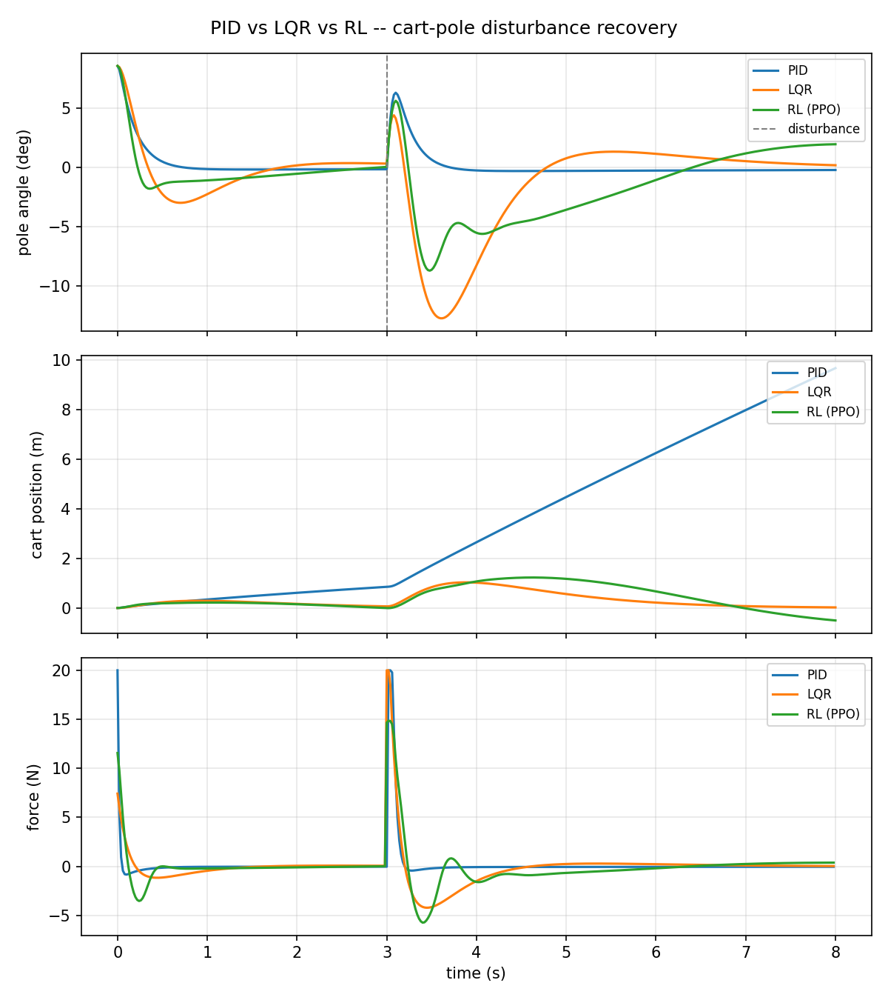
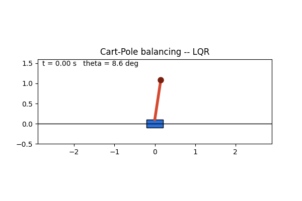
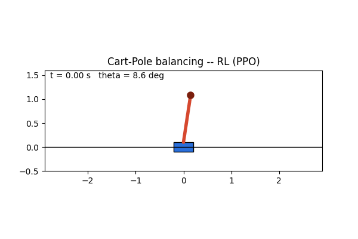

# Cart-Pole: Classical Control vs Reinforcement Learning

The same nonlinear cart-pole plant, balanced three different ways —
**PID**, **LQR**, and a **PPO reinforcement-learning policy trained from
scratch** — simulated with real equations of motion, animated, and compared
on identical disturbances.

**Live demo (Hugging Face Space):** <!-- HF_SPACE_URL -->

## The plant

A cart of mass $M$ slides on a frictionless rail. A rigid pole (mass $m$,
half-length $l$) pivots freely on top of it. A horizontal force $F$ on the
cart is the only control input. State is $[x, \dot{x}, \theta, \dot\theta]$,
with $\theta = 0$ at the upright equilibrium.

The nonlinear equations of motion (derived from Lagrangian mechanics for a
uniform rod on a cart — see `sim/dynamics.py`):

$$
\mathrm{temp} = \frac{F + m l \dot\theta^2 \sin\theta}{M + m}
$$

$$
\ddot\theta = \frac{g\sin\theta - \cos\theta \cdot \mathrm{temp}}
{l\left(\frac{4}{3} - \frac{m\cos^2\theta}{M+m}\right)}
\qquad\qquad
\ddot{x} = \mathrm{temp} - \frac{m l \ddot\theta \cos\theta}{M+m}
$$

These are integrated with a 4th-order Runge-Kutta step (`rk4_step`), not a
crude Euler step, so the simulated trajectories are accurate even for the
large swings a disturbance push can cause.

## Three controllers, one plant

| Controller | How it decides | What it "sees" |
|---|---|---|
| **PID** | `force = Kp*theta + Ki*∫theta dt + Kd*theta_dot` | Pole angle only |
| **LQR** | `force = -K @ state`, `K` from the continuous Riccati equation | Full state (angle, angle rate, cart position, cart velocity) |
| **RL (PPO)** | A neural-network policy learned purely from reward, with no model of the dynamics | Full state (normalized) |

**LQR.** The nonlinear dynamics are linearized about the upright
equilibrium via a numeric Jacobian (`sim/dynamics.linearize`), giving
$\dot{x} = Ax + Bu$. LQR then finds the gain $K$ minimizing

$$
J = \int_0^\infty \left( x^T Q x + u^T R u \right) dt
$$

by solving the continuous algebraic Riccati equation
$A^TP + PA - PBR^{-1}B^TP + Q = 0$ and setting $K = R^{-1}B^TP$,
$u = -Kx$.

**PID** only ever looks at the pole angle. One consequence shows up
directly in the results: PID has no notion of cart position, so it
happily balances the pole while drifting steadily off down the track —
something LQR, which penalizes cart position in $Q$, never does. That's
not a tuning bug, it's the structural difference between a
single-loop and a full-state optimal controller.

**RL (PPO).** A `gymnasium` environment (`rl/env.py`) wraps the identical
RK4 dynamics with a continuous force action and a quadratic reward
$-(\theta^2 + 0.1x^2 + 0.001F^2)$ — deliberately similar to the LQR cost, so
the comparison is "model-based optimal control" vs "the same objective,
learned by trial and error with no model." Training uses
`stable-baselines3` PPO with `VecNormalize` observation/reward scaling
(necessary because angle and position live on very different numeric
scales — without it, the policy never converges past wrong-sign control).

## Results

After an initial 8.6° pole tilt plus a mid-run angular-velocity disturbance
push at t=3s:

| Controller | Max \|angle\| | Max \|cart pos\| | Settle time after push | RMS force | Fell over |
|---|---|---|---|---|---|
| PID | 8.59° | **9.67 m** | 0.36 s | 2.20 N | No |
| LQR | 12.75° | 1.03 m | 1.50 s | 2.36 N | No |
| RL (PPO) | 8.72° | 1.23 m | 5.00 s | 2.34 N | No |

All three keep the pole up, but the *why* differs. **PID** damps the angle
fastest (0.36s) — but it only ever looks at the angle, so the cart itself
just keeps accelerating off down the track (9.67 m from center after 8
seconds, blowing straight past a real rail's limits). **LQR** is the only
one penalizing cart position in its cost function, so it reins the cart
back in (1.03 m) at the cost of a bigger angle swing (12.75°) immediately
after the push. **RL** matches LQR's spatial containment (1.23 m) without
ever being told to — it discovered a similar position-aware strategy purely
from reward — but it damps out far more slowly (5.0s vs LQR's 1.5s),
reflecting that it's a general-purpose learned policy rather than a
closed-form optimum for this exact linear(ized) cost. That gap only shows
up at all because the RL policy had to be deliberately trained with random
disturbance pushes and a large penalty for falling (see `rl/env.py`) —
without those, it balances a gentle start just fine but faceplants the
instant a real push arrives, which is itself a useful, honest result about
the difference between a model-based controller (robust by construction,
anywhere within its linear range) and a model-free one (only as robust as
what it was actually trained against).



| PID | LQR | RL (PPO) |
|---|---|---|
|  |  |  |

## Running it yourself

```bash
pip install -r requirements.txt

# train the RL policy (a few minutes on CPU)
python -m rl.train

# run all three controllers through the same disturbance test,
# save the comparison plot, metrics table, and per-controller GIFs
python compare.py
```

The interactive version (pick a controller, tilt angle, and disturbance
live) is in `space/app.py` and deployed as a Hugging Face Space — see
`space/README.md`.

## Project layout

```
sim/dynamics.py       nonlinear equations of motion + RK4 integrator + linearization
sim/experiment.py      shared simulate()/metrics() used by compare.py and the Space
sim/animate.py         matplotlib animation -> GIF (no ffmpeg dependency)
controllers/pid.py     PID on pole angle
controllers/lqr.py     LQR via the continuous Riccati equation
controllers/rl_controller.py   wraps a trained PPO policy with the same act(state) interface
rl/env.py              gymnasium environment wrapping the same dynamics for training
rl/train.py            PPO + VecNormalize training script
compare.py             runs all three, saves plot + metrics + animations
space/                 Hugging Face Space (Gradio) version of the same comparison
```
